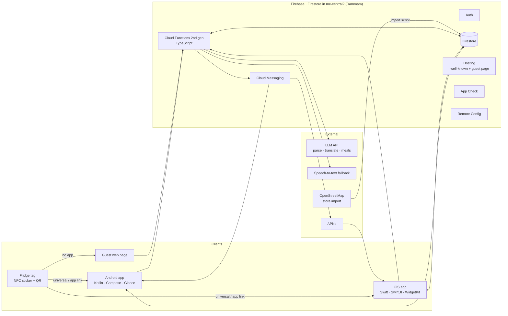
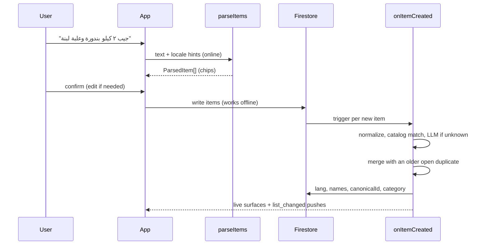
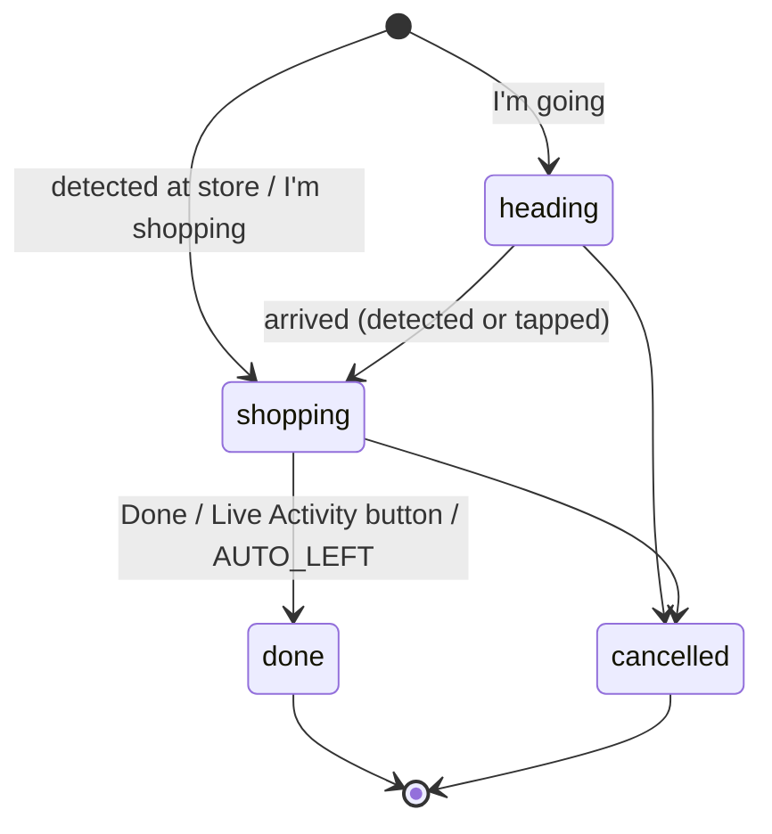

# Architecture — FridgeList (working name)

Two native apps and a guest web page read and write one household list in Firebase. Cloud Functions do everything that must be consistent across platforms (parsing, merging, translation, trips, pushes). Every shape they exchange is defined in `docs/CONTRACT.md`.

## 1. Overview



**Why two native apps:** the features that set the product apart — interactive widgets, Live Activities, Android 16 Live Updates, Controls, Quick Settings tiles, geofencing, NFC writing, App Intents — are platform APIs. Native code gets the best version of each, and Claude Code removes most of the cost of keeping two codebases. The price is drift between platforms, which the shared contract, shared fixtures and mirrored milestones keep in check.

## 2. Principles

1. **One contract.** `docs/CONTRACT.md` defines every field, enum, payload and link. Nothing is invented on one side.
2. **Offline-first.** Clients write straight to Firestore with offline persistence. Anything that needs consistency (merging, categories, translations) happens in triggers after the write, so adding never waits for the network.
3. **Server normalizes, clients render.** Clients may parse locally for speed, but the server is the final word on category, canonical item and translations.
4. **Location stays on the device.** Geofences are evaluated on the phone. The server learns only "trip started at store X".
5. **Arabic first.** Right-to-left layouts, Arabic-Indic digits and Arabic dialects are first-class, not afterthoughts.
6. **Cheap by default.** A catalog lookup handles most adds; the LLM handles the rest; results are cached.

## 3. Backend (Firebase)

### 3.1 Services and region

| Service | Use |
| --- | --- |
| Firestore (Native mode) | all app data; location `me-central2` (Dammam) to sit close to Gulf users and keep Saudi data in-Kingdom |
| Cloud Functions 2nd gen (TypeScript, Node 22) | callables, triggers, schedules, HTTP; deploy to the Firestore region if Functions supports it there, otherwise `me-central1` (Doha), then `europe-west1` |
| Auth | Sign in with Apple, Google; phone OTP later (SMS costs) |
| Cloud Messaging | all pushes, including iOS Live Activity start/update/end |
| Hosting | `LINK_DOMAIN`: `.well-known` files, guest page `/k/*`, join page `/join/*` |
| App Check | App Attest (iOS), Play Integrity (Android), reCAPTCHA Enterprise (web); debug providers in dev |
| Remote Config | feature flags (CONTRACT §10) |
| Cloud Storage | data exports now; item photos in phase 2 |
| Crashlytics, Analytics | no personal or item text in logs or events |

### 3.2 Environments

Two Firebase projects: `FIREBASE_PROJECT_DEV` and `FIREBASE_PROJECT_PROD` (aliases `dev` and `prod` in `.firebaserc`). Day-to-day work runs on the **Emulator Suite**; apps built in debug point at the emulators (Android emulator host `10.0.2.2`, iOS simulator `localhost`). Release builds never touch the emulators.

### 3.3 Security rules model

- `isMember(hid)`: `exists(/households/{hid}/members/{request.auth.uid})`.
- `roleOf(hid)`: read from the member doc.
- Collections marked "functions only" in CONTRACT §3 deny every client read and write except where noted (`stores`, `catalog` are readable by signed-in users; `trips`, `events`, `purchases` are readable by members).
- Items: create requires `addedBy == request.auth.uid`, valid enums, string lengths, `status` = `open` (or `pending` for kids, forced), server timestamps. Updates allow only the client-writable fields and the status transitions in CONTRACT §3.6. Server-owned fields (`lang`, `names`, `canonicalId`, `requestedBy`, `recipeRef`) are read-only to clients; `category` only with `categorySource: user`.
- Member docs: a member may update only their own `displayName`, `language`, `notify`.
- Aliases (`households/{hid}/aliases`): any member may create, update and delete; `createdBy` must be the caller.
- Lists: owner and adult may create and edit; only the owner deletes.
- Every rule has a test (`@firebase/rules-unit-testing`) — see §11.

### 3.4 Functions layout

```
backend/functions/src/
  callables/   createHousehold, createInvite, joinHousehold, parseItems, startTrip, updateTrip,
               registerLiveActivityToken, nearbyStores, addStore, createShareLink, revokeShareLink,
               resolveShareLink, guestAddItem, suggestMeals, mealToItems, transcribeAudio,
               exportMyData, deleteMyAccount, linkWhatsApp
  triggers/    onItemCreated, onItemUpdated, onMemberWritten, onTripWritten
  scheduled/   closeStaleTrips, cleanupLinks, computeUsuals*, learnAisleOrder*
  http/        whatsappWebhook*
  lib/         normalize, localSplit, units, catalog, merge, display, rateLimit, ids, time
  llm/         LlmProvider interface + Anthropic implementation + prompts + zod schemas
  stt/         SpeechToText interface + Google Cloud Speech-to-Text v2 implementation
  push/        fcm, liveActivity, templates
  i18n/        ar.json, tr.json, en.json (push text and default list names)
  meals/       seed_dishes.json, planner
* phase 2, disabled by Remote Config
```

Every callable validates input with zod, checks membership and role, and returns the shapes in CONTRACT §4.

### 3.5 LLM and speech

- **`LlmProvider`** interface with one implementation on the Anthropic SDK. Models come from params: `LLM_MODEL_FAST` (default `claude-haiku-5-5`) for parsing, classification and translation; `LLM_MODEL_SMART` (default `claude-sonnet-5-5`) for meal plans.
- Every LLM call asks for JSON that matches a schema (structured outputs, or a forced tool call), then validates with zod. Invalid output → one retry → fall back (local splitter for parsing, skip for translation, error for meals).
- Prompts live in `llm/prompts/*.md` with few-shot examples taken from `fixtures/parse_cases.json`. Temperature 0 for parsing.
- Golden tests replay recorded LLM responses (`test/recordings/`), so CI never calls the API. A `RECORD=1` run refreshes recordings against the real API on demand.
- **`SpeechToText`** interface; default Google Cloud Speech-to-Text v2 (same Google Cloud project, accepts OGG/Opus from WhatsApp and Android and AAC/MP4 from iOS). Only used when on-device recognition is unavailable or the user picks "cloud".

### 3.6 Pushes

- **FCM** for everything. Server text uses the recipient's `uiLanguage` and the templates in `src/i18n/`.
- **iOS Live Activities through FCM HTTP v1:** set `apns.live_activity_token` (push-to-start token for `start`, the activity's push token for `update`/`end`) and the `apns.payload` from CONTRACT §5.2. Push-to-start needs iOS 17.2+. If the `firebase-admin` version in use lacks the field, call the HTTP v1 REST endpoint with `google-auth-library`.
- **Throttle** live updates to one per trip per 5 seconds, always sending the newest state. The shopper's own app also updates its Live Activity / Live Update locally, so it stays instant on that device.
- **`list_changed`** data pushes (at most one per device per minute) let widgets refresh while apps are closed. On iOS they are best-effort silent pushes.

### 3.7 Hosting

- `/.well-known/apple-app-site-association` (no file extension, `Content-Type: application/json`):

```json
{ "applinks": { "details": [ { "appIDs": ["APPLE_TEAM_ID.IOS_BUNDLE_ID"], "components": [ { "/": "/k/*" }, { "/": "/join/*" }, { "/": "/l/*" } ] } ] } }
```

- `/.well-known/assetlinks.json` with `ANDROID_APPLICATION_ID` and the debug and release SHA-256 fingerprints.
- Both files are generated from the CLAUDE.md constants by `hosting/build.ts`.
- `/k/{token}`: a small static page (HTML + one TypeScript bundle, Arabic/Turkish/English, RTL) that calls `resolveShareLink` and `guestAddItem` through the Firebase JS SDK with App Check. Buttons: Copy (clipboard), Share (Web Share API, falls back to WhatsApp link), Add (scope `add` only), "Get the app" badges. No trackers.
- `/join/{code}`: explains how to join and links to the stores.

### 3.8 App Check, limits, secrets

- App Check enforced on all callables; public callables (`resolveShareLink`, `guestAddItem`) still require it.
- Rate limits stored in Firestore counters: `parseItems` 30/min/user, `suggestMeals` 10/hour/household, `guestAddItem` 20/hour/token, `transcribeAudio` 20/hour/user.
- Secrets with `defineSecret`: `ANTHROPIC_API_KEY`; phase 2: `WHATSAPP_TOKEN`, `WHATSAPP_APP_SECRET`, `WHATSAPP_VERIFY_TOKEN`. Emulator-only values in a gitignored `.env.local`.

### 3.9 Cost guardrails

- Catalog fast path before any LLM call; `catalogCandidates` caches LLM classifications by normalized text, so each new word costs one call ever.
- Translation fills only the languages actually used in the household (`memberLanguages`).
- Firestore listeners are scoped to one household; widgets read local snapshots, not Firestore.
- A Google Cloud budget alert at a monthly cap the owner sets (documented in `docs/RUNBOOK.md`).

## 4. Item pipeline



### 4.1 Normalization (one implementation per language: TypeScript, Kotlin, Swift, tested against the same fixtures)

- **Arabic:** strip tashkeel and tatweel; unify `أ إ آ` → `ا`, `ى` → `ي`; treat final `ة`/`ه` as equal when matching; Eastern digits `٠-٩` and `۰-۹` → `0-9`; Arabic comma `،` and `و` as separators (only when `و` starts a word followed by an item, not inside words like `ورق`).
- **Turkish:** locale-aware lowercasing (`İ` → `i`, `I` → `ı`); decimal comma `1,5`; separators `ve`, `ile`, `,`.
- **English:** separators `and`, `,`, `&`; strip filler ("we need", "get", "buy", "don't forget").
- **Numbers and fractions:** `نص` 0.5, `ونص` +0.5, `ربع` 0.25, `yarım` 0.5, `buçuk` +0.5, `half` 0.5, `a dozen` 12, `half a dozen` 6; number words one to twelve in all three languages.
- **Units:** `كيلو` kg, `غرام`/`جرام` g, `لتر` l, `علبة` pack (or can for canned food), `كيس` bag, `قنينة`/`قزازة` bottle, `ربطة` bunch, `كرتونة` tray (eggs) or box, `حبة` piece; `kilo`/`kg`, `gram`/`gr`, `litre`/`lt`, `paket` pack, `kutu` box (can for canned food), `şişe` bottle, `demet` bunch, `tane`/`adet` piece. Dozens become pieces.
- **Dialect rules the parser must know** (full list in `fixtures/catalog_seed.json` → `dialectRules`): `عيش` is bread in Egypt and usually rice in the Gulf; `لبن` is milk in Egypt, plain yogurt in the Levant and the yogurt drink in the Gulf; `بطاطا` is sweet potato in Egypt and potato elsewhere; `بندورة` = `طماطم`; `فراخ`/`جاج`/`دياي` = chicken.
- **Resolution order for a word:** household alias (CONTRACT §3.16) → dialect rule with locale hints and context words → catalog synonym → LLM. Always prefer the longest synonym match (`خبز عربي` over `خبز`, `رز بسمتي` over `رز`, `ıslak mendil` over `mendil`). When a dialect word is still ambiguous, the app shows the chip with both options; the user's pick is saved as a household alias, so it is asked only once.

### 4.2 Merge rule

When a new item matches an older `open` or `claimed` item in the same list (same `canonicalId`, else same normalized name): if units match, add quantities; otherwise append the new quantity to `notes`; add the new item's `addedBy` to `requestedBy`; delete the newer document; log an `item_merged` event. Kids' `pending` items never merge until approved.

### 4.3 Display rule (identical on every client)

```
title    = item.names[viewerLang] ?? (item.lang == viewerLang ? item.name : null)
           ?? item.names[household.defaultLanguage] ?? item.name
original = item.name   // show underneath, smaller, only when title != item.name
```

## 5. Stores and detection

### 5.1 Store data

- `backend/scripts/import-stores.ts` builds `stores/` from OpenStreetMap.
  - UAE and Saudi Arabia: Overpass API by country area, `shop` in `supermarket|convenience|greengrocer|butcher|bakery`, nodes and ways (`out center tags`).
  - Turkey is too large for the public Overpass instance: download Geofabrik's `turkey-latest.osm.pbf`, filter with `osmium tags-filter`, export GeoJSON, import.
  - `chainId` from `brand`/`brand:wikidata`/`name` through a mapping table: `migros`, `macrocenter`, `a101`, `bim`, `sok`, `carrefoursa`, `file`, `metro`, `onur`, `happy_center`, `panda`, `danube`, `tamimi`, `othaim`, `lulu`, `carrefour`, `nesto`, `spinneys`, `union_coop`, `waitrose`, `choithrams`, `viva`, `almaya`; anything else is `other`.
  - Dry-run mode prints counts per country and chain. Writes in batches of 400. Idempotent (`osm_<type>_<id>`). Re-run monthly.
- OSM data is ODbL-licensed: show "Store data © OpenStreetMap contributors" in Settings and on the guest page.
- Users can add a missing store (`addStore`); it works immediately for their household.

### 5.2 Detection rules (same on both platforms)

| Rule | Value |
| --- | --- |
| Store radius | 120 m on Android, 150 m on iOS |
| Dwell | Android: native `DWELL`, 2 min; iOS: skip if CoreMotion says the user was in a vehicle in the last 3 min |
| Watched stores | iOS: nearest 19 + 1 refresh circle (iOS limit is 20 regions per app); Android: nearest 90 + 1 refresh fence (limit 100) |
| Refresh | when the user leaves a 3 km circle around the last refresh point, call `nearbyStores` and replace the set |
| Fire only if | detection on, ≥ 1 open item, store not muted, no trigger for this store in the last 3 h |
| On fire | local notification `AUTO_ARRIVED` ("At {store} · {n} items") → `startTrip(status: shopping, auto: true)` → live surface |
| On leaving the store during an auto trip | local notification `AUTO_LEFT` ("Done shopping?") |

### 5.3 iOS implementation

- `StoreMonitor` (an actor) owns one `CLMonitor` named `stores` with `CLMonitor.CircularGeographicCondition`s (iOS 17+). Store conditions use identifiers `store:<storeId>`; the refresh circle is `refresh`.
- Events arrive even when the app was not running; the app gets a short background window. In that window: query `CMMotionActivityManager` for the last 3 minutes → apply the rules → post `AUTO_ARRIVED` → call `startTrip`. The backend then starts the Live Activity by push-to-start.
- `startMonitoringSignificantLocationChanges()` is a second trigger to rebuild the set if the refresh circle is missed.
- Permissions: ask "While Using" when the user turns detection on, explain, then `requestAlwaysAuthorization()`. Without "Always", show the manual "I'm shopping" flow.

### 5.4 Android implementation

- `StoreGeofenceManager` uses `GeofencingClient` with `GEOFENCE_TRANSITION_DWELL` (loitering delay 120,000 ms, `NEVER_EXPIRE`) for stores and `GEOFENCE_TRANSITION_EXIT` for the 3 km refresh fence.
- `GeofenceBroadcastReceiver` → `goAsync()` → expedited `ArrivalWorker` (WorkManager) → rules → `AUTO_ARRIVED` notification → `startTrip` → ongoing trip notification.
- Geofences are cleared on reboot and app update: re-register on `BOOT_COMPLETED`, `MY_PACKAGE_REPLACED`, when location is re-enabled, and after `GEOFENCE_NOT_AVAILABLE` errors.
- Permissions: `ACCESS_FINE_LOCATION` first, then `ACCESS_BACKGROUND_LOCATION` (on Android 11+ the user must pick "Allow all the time" in Settings — show clear steps). A prominent in-app disclosure comes before the system prompt, and the Play Console needs a background-location declaration with a short demo video.

## 6. Trips and live surfaces



- One active trip per shopper; several people can shop at once. `nextItems` skips items claimed by someone else.
- **Last call:** `lastCallUntil` drives a countdown on the shopper's surfaces; items added by others during the window are highlighted and shown as `latestAddBy`/`latestAddName`.
- `closeStaleTrips` ends trips older than 4 hours and ends their Live Activities.
- When a trip ends: summary (done, missing); missing items return to `open`; purchases recorded.

**iOS Live Activity lifecycle:** started locally (`Activity.request(..., pushType: .token)`) when the user taps "I'm going" or "I'm shopping" in the app; started by push-to-start for auto-detected trips. The app sends each activity push token through `registerLiveActivityToken`. Updated locally while the app runs and by push otherwise; ended by `updateTrip(done)` or the stale-trip job.

**Android Live Update lifecycle:** the app posts an ongoing notification as soon as a trip starts on that device. On API 36+ it uses `Notification.ProgressStyle` (one segment per item, progress = done), `setRequestPromotedOngoing(true)` and a short critical text ("7 left"); the manifest declares `POST_PROMOTED_NOTIFICATIONS`. Older versions get a standard ongoing notification. Updates come from the app's Firestore listener while it runs and from `trip_update` data pushes when the process is gone.

## 7. iOS app

### 7.1 Stack

| Item | Choice |
| --- | --- |
| Language and UI | Swift 6 language mode, SwiftUI, Observation (`@Observable`) |
| Deployment target | iOS 17.2 (push-to-start Live Activities). iOS 18 APIs (Controls) and iOS 26 APIs (SpeechAnalyzer) behind `#available` |
| Project | generated with XcodeGen from `ios/project.yml` (no hand-edited `.pbxproj`) |
| Packages (SPM) | firebase-ios-sdk (Auth, Firestore, Functions, Messaging, Crashlytics, Analytics, AppCheck, RemoteConfig), GoogleSignIn-iOS; tests: swift-snapshot-testing |
| Toolchain | latest stable Xcode on macOS |

### 7.2 Targets and layout

```
ios/
  project.yml
  FridgeList/                      app target
    App/ (FridgeListApp, AppModel, DI, DeepLinkRouter)
    Features/ (Onboarding, Lists, Add, Shopping, Trip, Household, Planner, Settings)
    Services/ (ItemService, TripService, StoreMonitor, LiveActivityService, SpeechService,
               NFCService, NotificationService, SnapshotService, PushService)
    Resources/ (Localizable.xcstrings, InfoPlist.xcstrings, AppShortcuts.xcstrings, Assets)
  FridgeListWidgets/               widget extension
    ListWidget, LockScreenWidgets, ShoppingLiveActivity, Controls (iOS 18+), WidgetBundle
  Shared/                          files compiled into BOTH targets
    ShoppingAttributes.swift, WidgetIntents.swift (ToggleItemIntent, OpenQuickAddIntent),
    LiveActivityIntents.swift (CheckNextItemIntent, FinishTripIntent)
  Packages/FridgeKit/              local Swift package (no UI)
    Models (CONTRACT types), Display (title rule §4.3), LocalSplit + Units + Normalize,
    SnapshotStore (App Group JSON), PendingOps, FirestoreREST, AuthShare
    Tests/ (uses ../../fixtures/*.json)
```

App Intents used by widgets and Live Activities live in `Shared/` with membership in both targets, which is the reliable way to share them.

### 7.3 Data flow

- Firestore SDK with persistent cache; repositories expose `AsyncStream`s scoped to the current household; views observe `@Observable` models.
- `SnapshotService` writes the CONTRACT §7 snapshot to the App Group container after changes (debounced 1 s) and calls `WidgetCenter.shared.reloadTimelines(ofKind:)` (throttled).
- Firebase Auth uses a shared keychain access group (`Auth.auth().useUserAccessGroup(...)`) so the widget extension can get fresh ID tokens.

### 7.4 Widgets, Live Activity, Controls, Siri

- **Home-screen `ListWidget`** (small, medium, large), configured with `AppIntentConfiguration` to pick a list. Rows have `Button(intent: ToggleItemIntent(...))`. The + button opens `{URL_SCHEME}://add?listId=…&mode=voice`.
- **Timeline provider:** reads the snapshot; when the system asks for a new timeline it also fetches fresh items through `FirestoreREST` (list documents with the shared ID token) and updates the snapshot. Refresh policy `.after(15 min)`.
- **Widget write path (`ToggleItemIntent`):** update the snapshot optimistically → append to `PendingOps` in the App Group → commit through Firestore REST `documents:commit` with an `updateTransforms` `REQUEST_TIME` for `doneAt`/`updatedAt` → remove from `PendingOps` on success → reload timelines. The app drains `PendingOps` with the SDK on launch.
- **Lock Screen widgets:** `accessoryCircular` (open count), `accessoryRectangular` (next 2 items), `accessoryInline`.
- **Live Activity and Dynamic Island:** store name, progress, next 3 items, last-call countdown with `Text(timerInterval:)`; compact shows the remaining count; buttons use `LiveActivityIntent` (`CheckNextItemIntent`, `FinishTripIntent`), which run in the app process and write with the SDK.
- **Controls (iOS 18+):** `QuickAddControl` (`ControlWidgetButton` running `OpenQuickAddIntent` with `openAppWhenRun = true`) and `StartShoppingControl`; users can place them in Control Center, on the Lock Screen and on the Action button.
- **App Intents and App Shortcuts:** `AddItemsIntent(text:, list:)`; when Siri runs it without text it asks "What should I add?" (free-text parameters can't sit inside a shortcut phrase). Phrases in `AppShortcuts.xcstrings` for English, Arabic and Turkish. Entities `ListEntity` and `ItemEntity` read from the snapshot.

### 7.5 Notifications

- Categories `TRIP_HEADING`, `TRIP_ARRIVED` (each with `UNTextInputNotificationAction` `ADD_ITEM`), `ITEM_MISSING`, and the local `AUTO_ARRIVED` (`OPEN_LIST`, `NOT_SHOPPING`) and `AUTO_LEFT` (`DONE_SHOPPING`, `STILL_HERE`).
- `UNUserNotificationCenterDelegate` handles replies in the background: split locally → write items with `addedVia: notification_reply`.
- FCM via `Messaging` with APNs token mapping; silent `list_changed` pushes reload widgets.

### 7.6 Voice

- `SpeechService`: `SFSpeechRecognizer(locale:)` with `requiresOnDeviceRecognition` when `supportsOnDeviceRecognition`; `AVAudioEngine`; live partial results. Locales: `ar-SA`, `ar-AE`, `tr-TR`, `en-US` (and the member's own if set).
- iOS 26+: use `SpeechAnalyzer`/`SpeechTranscriber` when the locale is supported and `speech_analyzer_enabled` is on.
- Cloud fallback: record AAC (`audio/mp4`, ≤ 15 s) → `transcribeAudio`.

### 7.7 NFC, QR, links

- Associated Domains `applinks:LINK_DOMAIN`; `DeepLinkRouter` handles `/k`, `/join`, `/l` and the custom scheme. Reading a tag needs no code: iPhones read NDEF URL tags in the background and open the universal link.
- Writing: `NFCNDEFReaderSession` → `NFCNDEFPayload.wellKnownTypeURIPayload(url:)` → write; handle capacity and read-only errors; never lock tags by default.
- QR: Core Image `CIFilter.qrCodeGenerator()`; share or print with `ShareLink`.

### 7.8 Localization

String Catalogs for `en`, `ar`, `tr` (UI, `InfoPlist`, App Shortcuts). SwiftUI mirrors layouts for Arabic automatically; use leading/trailing only. Users switch app language in iOS Settings (the app links there). Hijri dates through `Calendar(identifier: .islamicUmmAlQura)`.

### 7.9 Capabilities and Info.plist

Sign in with Apple; Push Notifications; App Groups (`group.IOS_BUNDLE_ID`); Keychain Sharing; Associated Domains; Near Field Communication Tag Reading (NDEF); Background Modes → Remote notifications. Info.plist: `NSSupportsLiveActivities = YES`, `NSLocationWhenInUseUsageDescription`, `NSLocationAlwaysAndWhenInUseUsageDescription`, `NSMotionUsageDescription`, `NSMicrophoneUsageDescription`, `NSSpeechRecognitionUsageDescription`, `NFCReaderUsageDescription` (all localized). Privacy manifests (`PrivacyInfo.xcprivacy`) for the app and the extension.

## 8. Android app

### 8.1 Stack and modules

| Item | Choice |
| --- | --- |
| Language and UI | Kotlin 2.x, Jetpack Compose (Material 3), Navigation Compose (type-safe routes) |
| SDK levels | `minSdk 26`; `compileSdk`/`targetSdk` = the level Google Play currently requires (36 or higher) |
| DI and async | Hilt, Coroutines, Flow |
| Storage | Firestore offline cache; DataStore for settings and the widget snapshot |
| Background | WorkManager |
| Widgets | Jetpack Glance |
| Firebase | BoM: Auth, Firestore, Functions, Messaging, Crashlytics, Analytics, App Check (Play Integrity), Remote Config |
| Sign-in | Credential Manager + Sign in with Google |
| Location | Play services location (Fused, Geofencing) |
| Tests | JUnit, Turbine, Robolectric, Compose UI tests, Roborazzi screenshots |

```
android/
  app/                      UI, features, platform integrations (widgets, tile, notifications, location, NFC)
  core/model/               pure Kotlin: CONTRACT types (kotlinx.serialization)
  core/i18n/                pure Kotlin: normalize, local splitter, units, display rule (tests use /fixtures)
  core/data/                Android library: Firestore + Functions repositories, snapshot writer
```

Flavors: `dev` (emulators, App Check debug provider) and `prod`.

### 8.2 Data flow

Repositories expose `Flow`s scoped to the current household; ViewModels map them to UI state; Compose screens render. `WidgetSnapshotWriter` writes the CONTRACT §7 snapshot to DataStore on change (debounced 1 s) and calls `ListWidget().updateAll(context)`.

### 8.3 Widgets, tile, shortcuts

- **Glance `ListWidget`:** resizable (2×2 count + next 2; 4×2 next 5; 4×4 full list), configuration activity to pick a list, checkboxes via `actionRunCallback<ToggleItemCallback>` (runs in the app process, writes with the SDK, then updates the snapshot), + opens `QuickAddActivity` in voice mode. Shows "At Migros · 7 left" during a trip.
- `list_changed` data pushes refresh widgets when the app is not running.
- **Quick Settings tile** `QuickAddTileService` → `QuickAddActivity` (transparent, voice-first). On API 34+ use the `PendingIntent` overload of `startActivityAndCollapse`.
- **App shortcuts:** static ("Add items", "I'm going") plus dynamic, one per list.

### 8.4 Notifications

- Channels: `trip` (ongoing, silent), `last_call` (high), `household` (default), `suggestions` (low). Ask for `POST_NOTIFICATIONS` (API 33+) with a rationale screen first.
- `trip_heading`/`trip_arrived` notifications carry a `RemoteInput` reply (`item_text`) handled by `AddFromNotificationReceiver`, which writes the items and updates the notification to "Added ✓".
- `TripNotificationManager` owns the ongoing trip notification and the Live Update behaviour in §6.

### 8.5 Location

As §5.4. A dev-only debug screen lists registered geofences and can simulate a DWELL for any store; `docs/` holds an `adb emu geo fix` script for emulator tests.

### 8.6 Voice

`SpeechRecognizer` with on-device recognition on API 31+ when available (`createOnDeviceSpeechRecognizer`), `RecognizerIntent.EXTRA_LANGUAGE` = the member's locale, partial results. Cloud fallback: `MediaRecorder` OGG/Opus (API 29+) ≤ 15 s → `transcribeAudio`.

### 8.7 NFC, QR, links

- App Links (`autoVerify`) for `https://LINK_DOMAIN` paths `/k/`, `/join/`, `/l/`; `NDEF_DISCOVERED` filter for the same URLs.
- Writing: `NfcAdapter.enableReaderMode` → `Ndef` or `NdefFormatable` → URI record; check `maxSize`; never lock by default. No Android Application Record, so phones without the app open the guest page.
- QR generation in Compose (ZXing core); share or print.

### 8.8 Localization

`values/`, `values-ar/`, `values-tr/` with plurals; `android:supportsRtl="true"`; per-app language through `AppCompatDelegate.setApplicationLocales` and `locales_config.xml`; start/end everywhere, never left/right. Hijri dates via `android.icu.util.IslamicCalendar` with the Umm al-Qura calculation type.

### 8.9 Manifest permissions

`INTERNET`, `POST_NOTIFICATIONS`, `ACCESS_FINE_LOCATION`, `ACCESS_COARSE_LOCATION`, `ACCESS_BACKGROUND_LOCATION`, `RECORD_AUDIO`, `NFC`, `RECEIVE_BOOT_COMPLETED`, `POST_PROMOTED_NOTIFICATIONS`. No foreground-service location type is needed.

## 9. Logic implemented three times

The same rules exist in TypeScript (backend), Kotlin (`core:i18n`) and Swift (`FridgeKit`): normalization (§4.1), the local splitter, units and numerals, the display rule (§4.3) and the default category order (CONTRACT §2). All three run the same test files in `fixtures/`. When one implementation changes behaviour, the fixtures change in the same commit and the other two must pass them before their next milestone closes.

## 10. Security and privacy

- Rules as §3.3, each with a test. App Check on every callable.
- Apps hold no secrets; only Firebase config files (kept out of public repos).
- Location: geofences on device; the backend stores only the trip's `storeId`/`storeName`; member presence is cleared when the trip ends.
- Analytics and crash logs never contain item, household or member names (CONTRACT §9).
- Account deletion in the app (both stores require it) and a web deletion link for Google Play; data export.
- Data-protection laws: Turkey's KVKK, Saudi Arabia's PDPL, the UAE's PDPL. Firestore in Dammam keeps Saudi data in-Kingdom; the privacy policy names processors (Google, the LLM provider) and purposes. Get a local legal review before launch.

## 11. Testing

| Layer | Tests |
| --- | --- |
| Rules | `@firebase/rules-unit-testing`: every collection, role and transition |
| Functions | vitest against the Emulator Suite; LLM replayed from recordings; push payload snapshot tests per type and language |
| Parser | golden test over `fixtures/parse_cases.json` (backend ≥ 90% pass); local splitter subset on all three platforms |
| Android | unit (core modules), Robolectric (receivers, notification builders, workers), Compose UI, Roborazzi screenshots in ar/tr/en, light/dark |
| iOS | Swift Testing for FridgeKit, XCUITest for onboarding → add → shop, swift-snapshot-testing in ar/tr/en, light/dark |
| Field | `docs/field-test.md`: one store per country, detection, last call across platforms, tag tap on both platforms |

CI (GitHub Actions): backend and Android on Linux runners on every push; iOS on a macOS runner nightly or on demand.

## 12. Release and operations

- **Google Play:** a new personal developer account must run a closed test with at least 12 testers opted in for 14 continuous days before production access; organization accounts are exempt. Start the closed test by early January. Also needed: Data safety form, background-location declaration with a demo video, account-deletion link.
- **App Store:** TestFlight beta, review notes explaining background location and Live Activities, in-app account deletion, privacy labels matching the privacy manifest.
- Crashlytics alerts, Remote Config kill switches (store detection, planner), a runbook for deploys, rollback and secret rotation.

## 13. Build order

1. Backend B1–B4 (scaffold, rules, households, item pipeline) — unblocks both apps.
2. Android A1–A6 and iOS I1–I6 in parallel (core app, add, shopping, "I'm going", notifications) while the backend does B5–B7.
3. Android A7–A10 and iOS I7–I12 (detection, live surfaces, widgets, tags, polish) while the backend does B8–B9.
4. Release milestones, closed testing, Ramadan planner switched on in late January.
